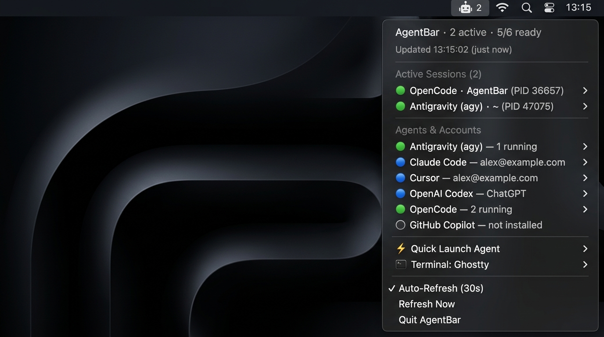

<div align="center">

# 🤖 AgentBar

**A native macOS menu bar monitor & launcher for AI coding agents, written in Rust.**

*Inspired by Omarchy's topbar agent menu — built with native AppKit (`NSStatusBar` + `NSMenu`), zero Electron, and sub-second startup.*

[](https://github.com/culcat/AgentBar/releases)
[-DEA584?style=flat-square&logo=rust&logoColor=black)](https://www.rust-lang.org/)
[](https://github.com/culcat/AgentBar/releases)
[](https://github.com/culcat/homebrew-tap)
[](LICENSE)

</div>

---

## ✨ Preview

<div align="center">
  
</div>

<details>
<summary>Menu structure (text view)</summary>

```text
🤖 2  (macOS Menu Bar)
├── AgentBar  ·  2 active  ·  5/6 ready
├── Updated 13:15:02 (just now)
├── ─────────────────────────────────────
├── Active Sessions (2)
│   ├── 🟢 OpenCode  ·  AgentBar  (PID 36657)        ▸  Finder / Terminal / Kill
│   └── 🟢 Antigravity (agy)  ·  ~  (PID 47075)      ▸  Finder / Terminal / Kill
├── ─────────────────────────────────────
├── Agents & Accounts
│   ├── 🟢 Antigravity (agy)  —  1 running           ▸  Account · Conversations · Launch
│   ├── 🔵 Claude Code  —  user@example.com          ▸  OAuth · Usage · Recent · Launch
│   ├── 🔵 Cursor  —  user@example.com               ▸  Plan · Workspaces · Open IDE
│   ├── 🔵 OpenAI Codex  —  ChatGPT                  ▸  Tokens · Threads · Launch
│   ├── 🟢 OpenCode  —  2 running                    ▸  Providers · Cost · Launch
│   └── ⚪ GitHub Copilot  —  not installed
├── ─────────────────────────────────────
├── ⚡ Quick Launch Agent                            ▸  New Session / Open IDE
├── Terminal: Ghostty                                ▸  Auto / Ghostty / iTerm2 / Warp / Terminal.app
├── ✓ Auto-Refresh (30s)
├── Refresh Now
└── Quit AgentBar
```

</details>

---

## 📦 Installation

### 🍺 Homebrew (Recommended)

```bash
brew tap culcat/tap
brew trust culcat/tap   # required once for custom taps on modern Homebrew
brew install --cask culcat/tap/agentbar
```

To upgrade later:

```bash
brew upgrade --cask agentbar
```

### 💿 DMG Installer

1. Download **`AgentBar-0.1.0.dmg`** (Universal macOS binary for Apple Silicon & Intel) from the [**GitHub Releases**](https://github.com/culcat/AgentBar/releases/latest) page.
2. Open the `.dmg` and drag **`AgentBar.app`** into **`Applications`**.
3. Launch **AgentBar** from Applications or Spotlight.

> [!NOTE]
> `AgentBar` runs as an accessory app (`LSUIElement = true`) — it appears only in the top menu bar without cluttering your Dock.

### 🦀 Build from Source

Requires Rust `1.85+` (Edition `2024`) on macOS:

```bash
git clone git@github.com:culcat/AgentBar.git
cd AgentBar

# Run directly in development
cargo run

# Build macOS .app bundle -> dist/AgentBar.app
./scripts/build-app.sh

# Build DMG installer -> dist/AgentBar-<version>.dmg
./scripts/build-dmg.sh
```

---

## 🚀 Features

- **Native macOS Menu Bar UI**: Built on `tray-icon` + `muda` + `tao` with a programmatic 22×22 monochrome template icon that automatically adapts to macOS Light and Dark mode.
- **Live Session Monitor**: Discovers running agent CLI and IDE processes via `ps` and `lsof` (resolving each process's working directory), while filtering out system XPC services and Electron helper processes.
- **Session Controls**: Inspect CPU%, RAM, and elapsed time for any running agent; open its working folder in Finder, open a terminal there, or terminate it (`SIGTERM`).
- **Accounts, Usage & Recent Sessions**: Reads local configuration and databases strictly in **read-only** mode — never exposing or logging OAuth tokens or API keys.
- **One-Click Agent Launcher**:
  - Launch interactive CLI sessions in **Ghostty**, **iTerm2**, **Warp**, or **Terminal.app** (auto-detected).
  - Pick any project directory with a native macOS folder picker (`Launch in Folder…`).
  - Pass an initial prompt straight from a native dialog (`Launch with Prompt…`).
  - Resume directly in a recent session's project directory or open GUI apps (`Antigravity IDE`, `Cursor`, `Claude`).
- **Non-Blocking Background Polling**: Refreshes every 30s on a dedicated worker thread so the menu bar always responds instantaneously.

---

## 🤖 Supported Agents

| Agent | CLI / App | Local State Inspected (Read-Only) |
|---|---|---|
| **Antigravity (`agy`)** | `agy`, `Antigravity IDE.app` | `~/.gemini/settings.json`, `google_accounts.json`, `~/.gemini/antigravity/brain` |
| **Claude Code** | `claude`, `Claude.app` | `~/.claude.json`, `~/.claude/profiles`, `stats-cache.json`, `history.jsonl` |
| **Cursor** | `cursor`, `Cursor.app` | `~/Library/Application Support/Cursor/.../state.vscdb`, `~/.cursor/projects` |
| **OpenAI Codex** | `codex` | `~/.codex/auth.json`, `~/.codex/state_5.sqlite` |
| **OpenCode** | `opencode` | `~/.local/share/opencode/auth.json`, `opencode.jsonc`, `opencode.db` |
| **GitHub Copilot** | `copilot`, `gh copilot` | `~/.copilot`, `~/.config/gh/hosts.yml` |

---

## 🧱 Architecture

```text
src/
├── main.rs          # Entry point & logger initialization
├── app.rs           # tao accessory event loop, TrayIcon & background worker threads
├── icon.rs          # Programmatic 22×22 monochrome template icon
├── menu.rs          # Dynamic NSMenu builder & MenuAction registry
├── model.rs         # Core domain types (AgentKind, QuotaMetric, ActiveSession, BarSnapshot)
├── launcher.rs      # Terminal/GUI launcher, folder picker, prompt dialog & process control
├── scanner/
│   ├── mod.rs       # Binary/app discovery, JSON/JSONC & read-only SQLite helpers
│   └── process.rs   # Live macOS process & CWD discovery (ps + lsof)
└── providers/
    ├── mod.rs       # AgentProvider trait & snapshot aggregation
    ├── agy.rs       # Antigravity provider
    ├── claude.rs    # Claude Code provider
    ├── cursor.rs    # Cursor provider
    ├── codex.rs     # OpenAI Codex provider
    ├── opencode.rs  # OpenCode provider
    └── copilot.rs   # GitHub Copilot provider
```

---

## 🧪 Development & Releasing

```bash
# Run unit tests & strict Clippy lints
cargo test
cargo clippy --all-targets -- -D warnings

# Tagging a release triggers GitHub Actions to build a Universal (.dmg) & publish to Releases
git tag v0.1.0
git push origin v0.1.0
```

See [AGENTS.md](AGENTS.md) for contributor guidelines, security rules, and instructions for adding new agent providers.

---

<div align="center">

MIT License · Made with 🦀 for macOS

</div>
